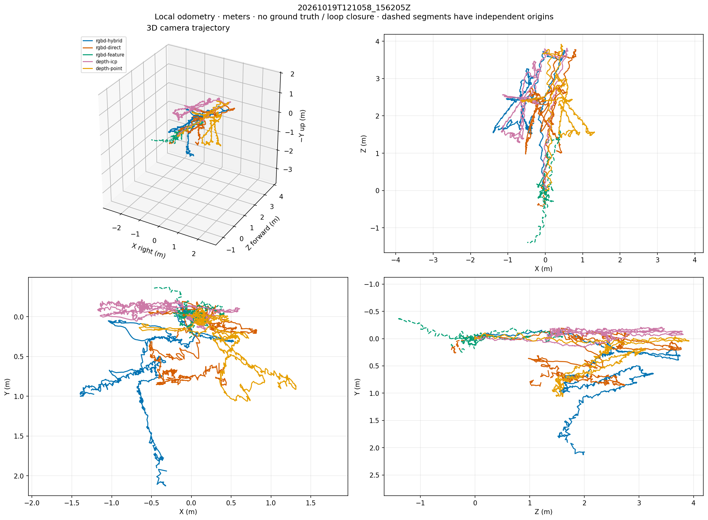

# RGB-D robot trajectory estimation

A self-contained comparison of five camera-odometry methods using the RealSense recording **`20261019T121058_156205Z`**. The camera was mounted on a moving robot.

This repository includes the original recording, calibration and timestamps, estimation and visualization code, tests, and the calculated results. The full comparison used **2,576 synchronized RGB/depth pairs over 85.887 seconds**, with 320×240 working images. These are camera poses in meters; converting them to robot-base poses requires the camera mounting transform.

## Results

| Implemented method | Input | Result on your recording |
|---|---|---|
| Hybrid photometric + geometric odometry | RGB + depth | One trajectory; 2 rejected frames |
| Direct photometric odometry | RGB + depth | 2 separate segments |
| Feature tracking + PnP RANSAC | RGB + depth | 31 segments; unreliable here |
| Point-to-plane ICP | Depth only | One trajectory |
| Trimmed point-to-point ICP | Depth only | One trajectory |

Start with RGB-D hybrid odometry as a baseline, and point-to-plane ICP as the depth-only comparison. The estimated paths disagree substantially; continuous tracking does not establish accuracy. The recording has no ground-truth robot poses. These methods do not include loop closure, and disconnected segments must not be joined into one trajectory.

- **[Interactive trajectory viewer](results/20261019T121058_156205Z/trajectory.html)** — rotate, zoom, toggle methods, animate time and inspect orientation. Download/clone the repository and open this file in a browser. The HTML includes its trajectory data and works offline; a repository file preview may display its source instead of running it.
- [Trajectory comparison image](results/20261019T121058_156205Z/trajectory_comparison.png)
- [Tracking diagnostics](results/20261019T121058_156205Z/tracking_diagnostics.png)
- [Run parameters and statistics](results/20261019T121058_156205Z/summary.json)
- [Algorithm details, calibration and coordinate conventions](docs/METHODS.md)



## Folder layout

```text
rgbd-trajectory/
├── README.md
├── estimate_trajectory.py             # all five estimation methods and exports
├── trajectory_viewer.html             # HTML template used by the estimator
├── test_estimate_trajectory.py         # geometry/calibration/failure tests
├── requirements.txt                   # supported dependency ranges
├── requirements-tested.txt            # exact installed package versions
├── .gitattributes                     # Git LFS rules for raw images/video
├── .gitignore                         # excludes caches, environments and new runs
├── SHA256SUMS                         # checksums for the packaged files
├── provenance.json                    # source mapping and reproduction command
├── docs/
│   └── METHODS.md
├── data/
│   └── 20261019T121058_156205Z/
│       ├── metadata.json              # intrinsics, extrinsics and depth scale
│       ├── timestamps.csv             # original per-stream timestamps
│       ├── rgb/                       # 2,578 lossless RGB PNGs
│       ├── depth/                     # 2,582 uint16 depth PNGs
│       └── rgb.mp4                    # optional original preview, not used by estimators
└── results/
    └── 20261019T121058_156205Z/
        ├── trajectory.html            # generated viewer with embedded pose data
        ├── trajectory_comparison.png
        ├── tracking_diagnostics.png
        ├── summary.json
        ├── METHOD.csv                 # timestamped poses and tracking status
        ├── METHOD.npz                 # 4×4 matrices and exact int64 timestamps
        └── METHOD_segmentNN.tum       # accepted poses, one file per local segment
```

The original data and generated results are copied without changes. The packaged estimator only changes its default input/output paths to suit this layout; its estimation algorithms and parameters are unchanged. Historical paths inside `summary.json` document the original run and are not required to reproduce it.

## Install and reproduce

Use Python 3.12 to match the tested environment. Run commands from this repository's root:

```bash
python -m venv .venv
source .venv/bin/activate
python -m pip install -r requirements-tested.txt

# Verify data and packaged files after obtaining the full Git LFS payloads.
sha256sum -c SHA256SUMS

# Geometry, calibration, depth-only and failure-handling tests.
python -m unittest -v test_estimate_trajectory.py

# Full comparison: all five methods, every synchronized frame.
python estimate_trajectory.py data/20261019T121058_156205Z \
  --methods all --output runs/comparison

# View the bundled results on Linux.
xdg-open results/20261019T121058_156205Z/trajectory.html
```

Open the same HTML file directly in a browser on other platforms. Keep the neighboring PNG, CSV and summary files with it so its download links and static plots work.

The original full estimation took approximately five minutes on the recording machine. New output directories must be empty. New runs go under `runs/`, which is ignored by Git. Running `python estimate_trajectory.py` without arguments uses the included recording and writes to `runs/20261019T121058_156205Z/`.

Other useful commands:

```bash
# Recommended RGB-D baseline.
python estimate_trajectory.py --methods rgbd-hybrid --output runs/hybrid

# Depth-only: no RGB image, intensity, mask or motion prior is used.
python estimate_trajectory.py --methods depth-icp depth-point --output runs/depth

# Short end-to-end check.
python estimate_trajectory.py --max-frames 30 --output runs/smoke

# Command-line parameters, including depth range and tracking limits.
python estimate_trajectory.py --help
```

`requirements.txt` provides broader supported version ranges if you cannot use the tested versions. Install **opencv-contrib-python**, which supplies `cv2.rgbd`; avoid also installing the separate `opencv-python` package in the same environment. The offline viewer needs no Python packages, server or internet connection.

## Data and pose conventions

- The complete recording is included, approximately **1.52 GB** including results. Other recording sessions are not part of this repository.
- RGB/depth PNGs are matched by timestamps, not filenames. Raw depth is not aligned to RGB; the script uses the saved intrinsics and depth-to-color extrinsic to sample RGB on the depth grid.
- Depth is converted to meters using `depth_scale_meters` from `metadata.json`. Depth-only runs use the depth timestamps and do not require RGB files.
- Poses map the current depth-camera optical frame into the initial depth-camera frame of their segment: **X right, Y down, Z forward**. Quaternions are ordered **qx, qy, qz, qw**. The frame is not gravity aligned.
- CSV rows contain tracking status and segment ID. Rejected poses are blank in CSV and NaN in NPZ. After prolonged tracking loss, a new segment starts at its own independent origin.
- The scene contains moving people, occlusions and glass. Tracking diagnostics are consistency checks, not absolute error measurements. See [METHODS.md](docs/METHODS.md) for limitations and the camera-to-robot transformation.

## Push to a repository

Raw PNGs and the preview video are configured for **Git LFS** in `.gitattributes`. Scripts, calibration, timestamps, the interactive HTML and calculated results remain regular Git files. Install Git LFS before staging the raw data.

For a new repository, run from this folder:

```bash
git init -b main
git lfs install --local
git add .
git lfs ls-files
git commit -m "Add RGB-D trajectory data, estimators and visualized results"
git remote add origin YOUR_REPOSITORY_URL
git push -u origin main
```

For an existing repository, copy these contents into it and use its existing branch/remote. The commands above are instructions; this folder has not been initialized, committed or pushed automatically.

After cloning, obtain the raw files with:

```bash
git lfs install --local
git lfs pull
sha256sum -c SHA256SUMS
```

The checksum file describes this packaged snapshot; update it if you deliberately change tracked files.
